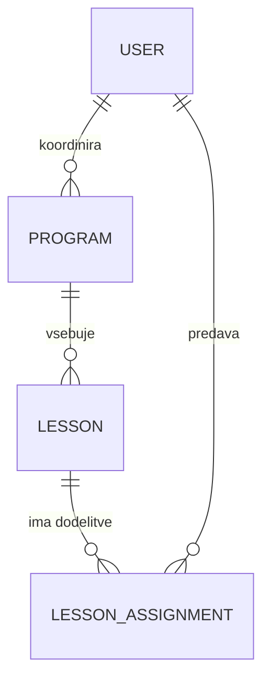

# 03 – Podatkovni model

## Diagram povezav med entitetami (ER)

**Povezave:**

- `user` 1 : N `program`
- `program` 1 : N `lesson`
- `lesson` N : M `user`, prek tabele `lesson_assignment`

## Podrobnosti entitet

### user

- id: bigint, PK
- email: varchar, unikaten
- password: varchar
- full_name: varchar
- role: enum (ADMIN, COORDINATOR, LECTURER)
- is_active: boolean
- created_at: timestamp

### program

- id: bigint, PK
- title: varchar
- description: text, lahko prazno
- coordinator_id: bigint, FK na user
- locked_until: date, lahko prazno (vse lekcije, ki se začnejo pred tem datumom, so zaklenjene; prazno pomeni, da ni zaklenjeno nič)
- created_at: timestamp
- updated_at: timestamp

### lesson

- id: bigint, PK
- program_id: bigint, FK na program
- title: varchar
- description: text, lahko prazno
- starts_at: timestamptz
- ends_at: timestamptz (mora biti kasneje kot starts_at)

### lesson_assignment

- id: bigint, PK
- lesson_id: bigint, FK na lesson
- user_id: bigint, FK na user
- status: enum (ASSIGNED, REPORTED, CONFIRMED, REJECTED)
- attendance: enum (PRESENT, ABSENT), lahko prazno (prazno, dokler predavatelj ne prijavi)
- reported_at: timestamptz, lahko prazno
- reviewed_by: bigint, FK na user, lahko prazno
- reviewed_at: timestamptz, lahko prazno
- review_comment: text, lahko prazno
