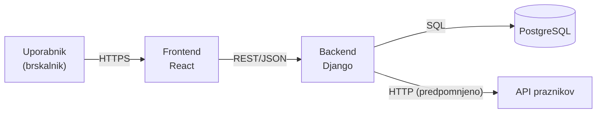

# 04 – Arhitektura in tehnološki sklad

## Arhitektura

### Glavni deli sistema

- **Frontend:** uporabniški vmesnik v brskalniku (prijava, koledar, obrazci, grafikoni). Podatke dobiva prek REST API-ja.
- **Backend (REST API):** poslovna logika, preverjanje pravic glede na vlogo, zaznavanje prekrivanj terminov, zaklep meseca, izvoz .ics.
- **Podatkovna baza:** trajno shranjevanje uporabnikov, programov, lekcij in dodelitev.
- **Zunanji API za praznike:** javni API z državnimi prazniki, ki ga backend predpomni in posreduje frontendu.

### Diagram

### Komunikacija med deli sistema

- Frontend in backend komunicirata prek REST API-ja v formatu JSON. Vsaka zaščitena zahteva vsebuje avtorizacijsko glavo.
- Backend do baze dostopa prek ORM-ja. Operacije, ki posegajo v več tabel, potekajo v transakciji.
- Backend enkrat dnevno pridobi praznike iz zunanjega API-ja in jih predpomni, zato frontend ni odvisen od razpoložljivosti te storitve.

### Podatkovna baza

Podatkovna baza je **PostgreSQL**, shemo pa upravljamo z Django migracijami.

### Avtentikacija in upravljanje uporabnikov

- Uporabniki se prijavijo z e-pošto in geslom. Gesla so shranjena zgoščeno (hash).
- Ob prijavi backend izda JWT.
- Avtorizacija glede na vlogo: lastni DRF razredi pravic preverjajo polje `user.role`.
- Uporabniki, ki se registrirajo sami, dobijo vlogo predavatelja. Vlogo lahko spremeni samo administrator.

### Lokalni zagon

Celoten projekt se lokalno zažene z orodjem Docker Compose, ki zažene tri vsebnike:

- **db:** podatkovna baza PostgreSQL.
- **backend:** aplikacija Django. Ob zagonu izvede migracije baze in naloži demo podatke (po enega uporabnika za vsako vlogo).
- **frontend:** aplikacija React, ki jo streže razvojni strežnik Vite.

Za zagon projekta novi razvijalec potrebuje samo nameščen Docker. Sam razvoj poteka v orodju Visual Studio Code.

## Tehnološki sklad

- **Frontend:** React (Vite), React Router, TailwindCSS, Recharts
- **Backend:** Python 3.12, Django, Django REST Framework
- **Podatkovna baza:** PostgreSQL 16
- **Avtentikacija:** JWT z lastnimi DRF razredi pravic za dostop glede na vlogo
- **Lokalni razvoj:** Visual Studio Code, Docker Compose
- **Verzioniranje:** Git in GitHub

## Arhitekturne odločitve

- **Ločen frontend in backend (REST API):** pravice in poslovna pravila so na enem mestu, v backendu, API pa lahko pozneje uporabljajo tudi drugi odjemalci.
- **Django z Django REST Framework:** vgrajeni uporabniki, ORM in migracije omogočajo hiter razvoj pri domeni, ki je večinoma relacijska.
- **PostgreSQL:** podatki so sestavljeni iz povezanih tabel, zato potrebujemo tuje ključe, enolične omejitve (UNIQUE) in transakcije.
- **JWT namesto sejnih piškotkov:** API ostane brez stanja in ga je preprosto uporabljati iz spletne aplikacije in iz drugih odjemalcev.

Vsaka od teh odločitev je podrobneje zapisana v obliki ADR (kontekst, obravnavane alternative, utemeljitev in posledice) v mapi [`adr/`](adr/).

## Možnosti nadaljnjega razvoja

Sistem je zasnovan tako, da je mogoče nove zmožnosti dodajati brez večjih sprememb jedra. V prihodnje bi ga lahko razširili z e-poštnimi obvestili, na primer ob dodelitvi predavatelja lekciji, ob zavrnjeni prijavi ali kot opomnik za prijavo prisotnosti. Uvedli bi lahko novo vlogo udeleženca, s katero bi spremljali prisotnost po udeležencih in ne le po predavateljih. Množični uvoz iz CSV bi koordinatorju omogočil, da naenkrat naloži urnik celotnega semestra ali seznam predavateljev, namesto da bi vsako lekcijo vnašal ročno. Ker bi vse to potekalo prek istega REST API-ja, bi obstoječi deli sistema ostali v glavnem nespremenjeni.
