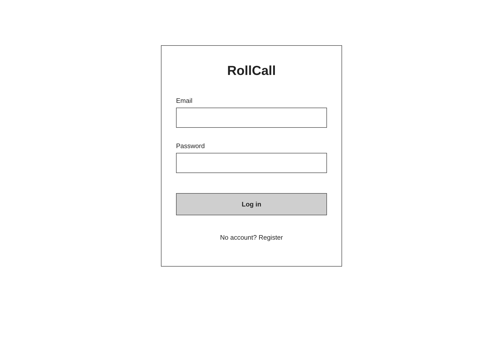
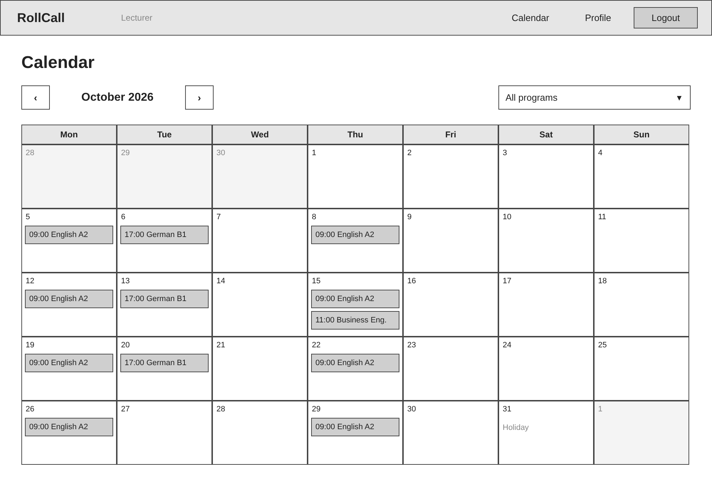
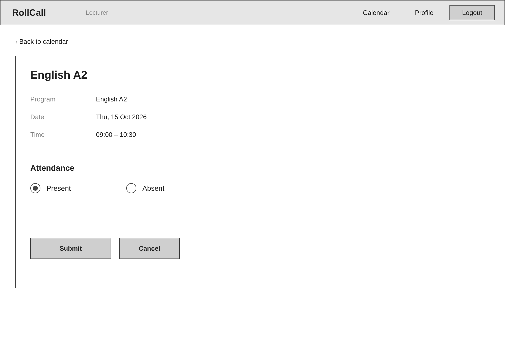
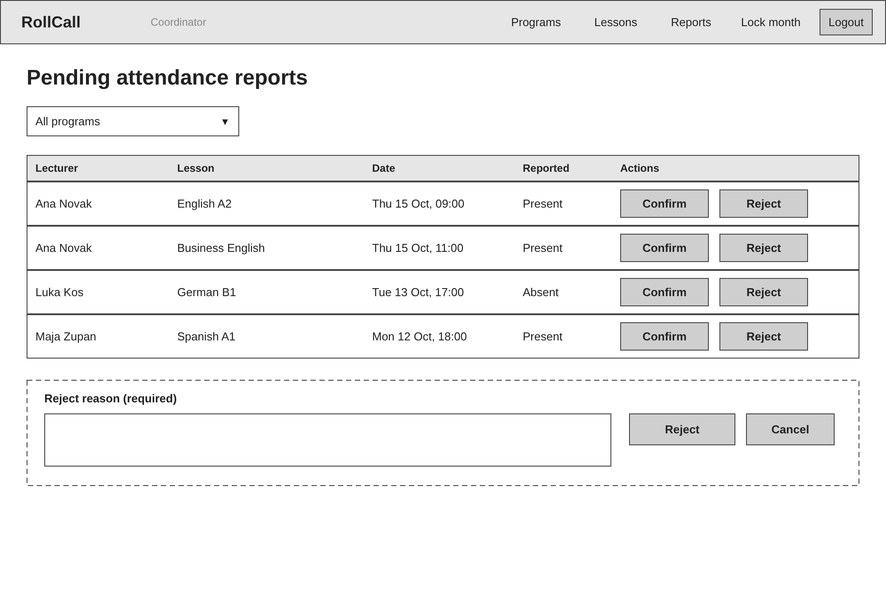

# Wireframes – RollCall

Spodaj so low-fidelity wireframes štirih ključnih zaslonov aplikacije RollCall. Besedila na slikah so v angleščini, kot v uporabniškem vmesniku. Slike so v mapi `wireframes/`, izvorna datoteka za urejanje (vse štiri strani) pa je `wireframes/wireframes.drawio` (draw.io).

## 1. Prijava (F1)

Zaslon za prijavo uporabnika z vnosnima poljema za e-pošto in geslo, gumbom »Log in« in povezavo na registracijo.

## 2. Koledar predavatelja (F5)

Mesečni koledar lekcij, dodeljenih prijavljenemu predavatelju. Zgoraj sta izbira meseca (puščici) in filter po programu; lekcije so prikazane v pripadajočih dnevih, državni praznik pa je označen v svojem dnevu. Klik na lekcijo odpre zaslon za prijavo prisotnosti.

## 3. Prijava prisotnosti (F6)

Podrobnosti izbrane lekcije (program, datum, ura) in izbira med »Present« in »Absent« z gumboma »Submit« in »Cancel«. Povezava na vrhu vodi nazaj v koledar.

## 4. Čakajoče prijave prisotnosti (F7)

Zaslon koordinatorja s tabelo prijav, ki čakajo na odločitev (predavatelj, lekcija, datum, prijavljena prisotnost), in filtrom po programu. Vsaka vrstica ima gumba »Confirm« in »Reject«; zavrnitev zahteva vnos razloga (črtkano polje spodaj).
